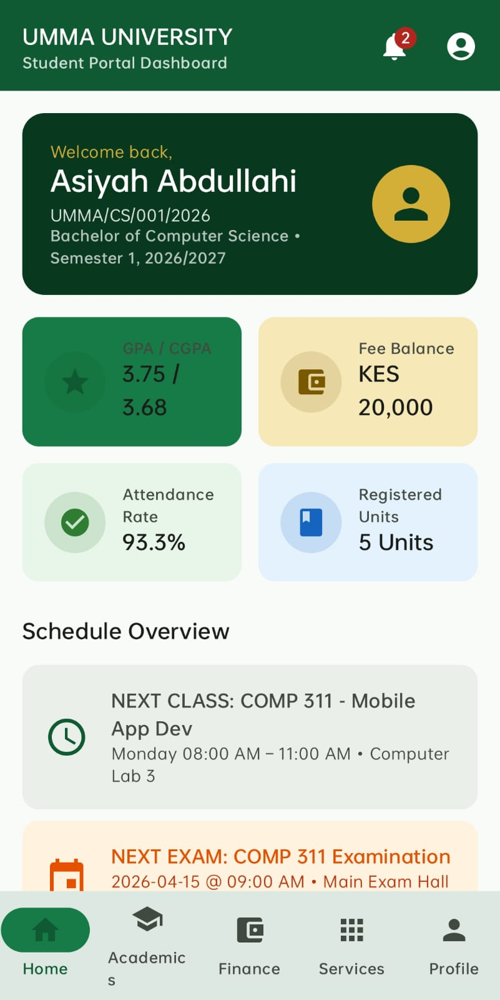
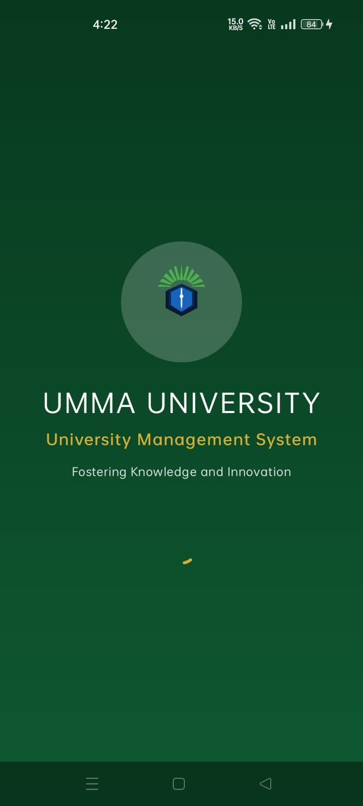

# UMMA UNIVERSITY MOBILE APPLICATION
## PROJECT REPORT & USER MANUAL

**Course**: Mobile Application Development  
**Institution**: UMMA University  
**Technology Stack**: Kotlin 2.0+, Android Studio, Jetpack Compose, Room Database (SQLite), Material 3 Design, Navigation Compose  
**Architecture Pattern**: MVVM (Model-View-ViewModel) + Repository Pattern  
**Date**: November 2026  

---

## 1. EXECUTIVE SUMMARY

The UMMA University Mobile Application was commissioned to provide a centralized, secure, and intuitive digital portal for students, lecturers, administrators, and university staff. The system facilitates seamless academic information access, course registrations, result checking, class attendance logging, assignment submission and grading, library book reservations, fee payment statements, and help desk ticket resolution.

Developed natively in Kotlin using Jetpack Compose and Room Database, the application implements robust role-based access control, reactive data streams via Kotlin Coroutines and StateFlow, and compile-time code generation via Google KSP.

---

## 2. SYSTEM DESIGN & ARCHITECTURE

The application implements the standard Android MVVM (Model-View-ViewModel) architecture with a clean repository layer.

<svg viewBox="0 0 800 600" width="100%" xmlns="http://www.w3.org/2000/svg" style="max-width:800px; display:block; margin:20px auto; background:#ffffff;">
  <rect x="20" y="20" width="760" height="90" rx="12" fill="#E3F2FD" stroke="#2196F3" stroke-width="2.5"/>
  <text x="400" y="55" font-family="'Times New Roman', Times, serif" font-size="16" font-weight="bold" fill="#0D47A1" text-anchor="middle">UI LAYER (Jetpack Compose)</text>
  <text x="400" y="82" font-family="'Times New Roman', Times, serif" font-size="13" fill="#1565C0" text-anchor="middle">Material 3 Components  |  Custom Vector Drawables  |  Top App Bars</text>

  <line x1="400" y1="110" x2="400" y2="165" stroke="#555" stroke-width="2.5" marker-end="url(#arrow)"/>
  <rect x="270" y="125" width="260" height="26" rx="6" fill="#FFFFFF" stroke="#CCCCCC" stroke-width="1"/>
  <text x="400" y="142" font-family="'Times New Roman', Times, serif" font-size="12" fill="#333" text-anchor="middle">StateFlow &amp; Navigation Events</text>

  <rect x="20" y="165" width="760" height="90" rx="12" fill="#E8F5E9" stroke="#4CAF50" stroke-width="2.5"/>
  <text x="400" y="200" font-family="'Times New Roman', Times, serif" font-size="16" font-weight="bold" fill="#1B5E20" text-anchor="middle">VIEWMODEL LAYER</text>
  <text x="400" y="227" font-family="'Times New Roman', Times, serif" font-size="13" fill="#2E7D32" text-anchor="middle">AuthViewModel  *  StudentViewModel  *  LecturerViewModel  *  AdminViewModel</text>

  <line x1="400" y1="255" x2="400" y2="310" stroke="#555" stroke-width="2.5" marker-end="url(#arrow)"/>
  <rect x="270" y="270" width="260" height="26" rx="6" fill="#FFFFFF" stroke="#CCCCCC" stroke-width="1"/>
  <text x="400" y="287" font-family="'Times New Roman', Times, serif" font-size="12" fill="#333" text-anchor="middle">Coroutines Flow Data Stream</text>

  <rect x="20" y="310" width="760" height="90" rx="12" fill="#FFF3E0" stroke="#FF9800" stroke-width="2.5"/>
  <text x="400" y="345" font-family="'Times New Roman', Times, serif" font-size="16" font-weight="bold" fill="#E65100" text-anchor="middle">REPOSITORY LAYER</text>
  <text x="400" y="372" font-family="'Times New Roman', Times, serif" font-size="13" fill="#EF6C00" text-anchor="middle">UmmaRepository</text>

  <line x1="400" y1="400" x2="400" y2="455" stroke="#555" stroke-width="2.5" marker-end="url(#arrow)"/>
  <rect x="280" y="415" width="240" height="26" rx="6" fill="#FFFFFF" stroke="#CCCCCC" stroke-width="1"/>
  <text x="400" y="432" font-family="'Times New Roman', Times, serif" font-size="12" fill="#333" text-anchor="middle">Room DAO Interfaces</text>

  <rect x="20" y="455" width="760" height="90" rx="12" fill="#F3E5F5" stroke="#9C27B0" stroke-width="2.5"/>
  <text x="400" y="490" font-family="'Times New Roman', Times, serif" font-size="16" font-weight="bold" fill="#4A148C" text-anchor="middle">DATA LAYER (Room Database)</text>
  <text x="400" y="517" font-family="'Times New Roman', Times, serif" font-size="13" fill="#6A1B9A" text-anchor="middle">"umma_university_db" SQLite Engine via KSP</text>

  <defs>
    <marker id="arrow" viewBox="0 0 10 10" refX="6" refY="5" markerWidth="6" markerHeight="6" orient="auto-start-reverse">
      <path d="M 0 0 L 10 5 L 0 10 z" fill="#555"/>
    </marker>
  </defs>
</svg>

### Architectural Layer Responsibilities:
1. **UI Layer (Jetpack Compose)**: Declarative Composables observing reactive `StateFlow` streams from ViewModels. Renders responsive Material 3 components and custom vector drawables.
2. **ViewModel Layer**: Manages business logic, authentication sessions, GPA computations, fee balance updates, and form validations. Retains state across configuration changes.
3. **Repository Layer (`UmmaRepository`)**: Acts as a single source of truth, mediating data operations between DAOs and ViewModels.
4. **Data Layer (Room Database)**: Manages 22 relational SQLite tables on-device with compile-time code generation via Google KSP.

---

## 3. ROLE-BASED ACCESS CONTROL & PERMISSIONS

The application enforces strict role-based authorization branching directly from authentication:

<svg viewBox="0 0 800 500" width="100%" xmlns="http://www.w3.org/2000/svg" style="max-width:800px; display:block; margin:20px auto; background:#ffffff;">
  <rect x="260" y="20" width="280" height="80" rx="10" fill="#E8EAF6" stroke="#3F51B5" stroke-width="2.5"/>
  <text x="400" y="52" font-family="'Times New Roman', Times, serif" font-size="15" font-weight="bold" fill="#1A237E" text-anchor="middle">AUTHENTICATION</text>
  <text x="400" y="76" font-family="'Times New Roman', Times, serif" font-size="12" fill="#283593" text-anchor="middle">Login / Quick Fill Chips</text>

  <path d="M 400 100 L 400 135 M 140 135 L 660 135 M 140 135 L 140 165 M 400 135 L 400 165 M 660 135 L 660 165" stroke="#3F51B5" stroke-width="2.5" fill="none" marker-end="url(#arrow)"/>

  <rect x="30" y="165" width="220" height="310" rx="8" fill="#E3F2FD" stroke="#1E88E5" stroke-width="2.5"/>
  <rect x="30" y="165" width="220" height="40" rx="8" fill="#1E88E5"/>
  <rect x="30" y="195" width="220" height="10" fill="#1E88E5"/>
  <text x="140" y="191" font-family="'Times New Roman', Times, serif" font-size="14" font-weight="bold" fill="#FFFFFF" text-anchor="middle">STUDENT ROLE</text>
  <text x="50" y="235" font-family="'Times New Roman', Times, serif" font-size="12" fill="#0D47A1">• Course Reg</text>
  <text x="50" y="275" font-family="'Times New Roman', Times, serif" font-size="12" fill="#0D47A1">• View Results</text>
  <text x="50" y="315" font-family="'Times New Roman', Times, serif" font-size="12" fill="#0D47A1">• Pay Fees (M-Pesa)</text>
  <text x="50" y="355" font-family="'Times New Roman', Times, serif" font-size="12" fill="#0D47A1">• Reserve Books</text>
  <text x="50" y="395" font-family="'Times New Roman', Times, serif" font-size="12" fill="#0D47A1">• Submit Tickets</text>

  <rect x="290" y="165" width="220" height="310" rx="8" fill="#E8F5E9" stroke="#43A047" stroke-width="2.5"/>
  <rect x="290" y="165" width="220" height="40" rx="8" fill="#43A047"/>
  <rect x="290" y="195" width="220" height="10" fill="#43A047"/>
  <text x="400" y="191" font-family="'Times New Roman', Times, serif" font-size="14" font-weight="bold" fill="#FFFFFF" text-anchor="middle">LECTURER ROLE</text>
  <text x="310" y="235" font-family="'Times New Roman', Times, serif" font-size="12" fill="#1B5E20">• Attendance Log</text>
  <text x="310" y="275" font-family="'Times New Roman', Times, serif" font-size="12" fill="#1B5E20">• Post Assignment</text>
  <text x="310" y="315" font-family="'Times New Roman', Times, serif" font-size="12" fill="#1B5E20">• Enter Marks/GP</text>
  <text x="310" y="355" font-family="'Times New Roman', Times, serif" font-size="12" fill="#1B5E20">• View Submissions</text>

  <rect x="550" y="165" width="220" height="310" rx="8" fill="#FFF3E0" stroke="#FB8C00" stroke-width="2.5"/>
  <rect x="550" y="165" width="220" height="40" rx="8" fill="#FB8C00"/>
  <rect x="550" y="195" width="220" height="10" fill="#FB8C00"/>
  <text x="660" y="191" font-family="'Times New Roman', Times, serif" font-size="14" font-weight="bold" fill="#FFFFFF" text-anchor="middle">ADMINISTRATOR</text>
  <text x="570" y="235" font-family="'Times New Roman', Times, serif" font-size="12" fill="#E65100">• Manage Users</text>
  <text x="570" y="275" font-family="'Times New Roman', Times, serif" font-size="12" fill="#E65100">• Manage Courses</text>
  <text x="570" y="315" font-family="'Times New Roman', Times, serif" font-size="12" fill="#E65100">• Manage Fees</text>
  <text x="570" y="355" font-family="'Times New Roman', Times, serif" font-size="12" fill="#E65100">• Resolve Tickets</text>

  <defs>
    <marker id="arrow" viewBox="0 0 10 10" refX="6" refY="5" markerWidth="6" markerHeight="6" orient="auto-start-reverse">
      <path d="M 0 0 L 10 5 L 0 10 z" fill="#3F51B5"/>
    </marker>
  </defs>
</svg>

### Role Permissions Matrix:

| Operational Feature | Student | Lecturer | Administrator |
| :--- | :---: | :---: | :---: |
| **View Portal Dashboards & Schedules** | Granted | Granted | Granted |
| **Course Unit Registration (Add / Drop)** | Granted | Denied | Denied |
| **View Semester Results & Transcripts** | Granted | Denied | Granted |
| **Class Attendance Recording** | Denied | Granted | Denied |
| **Post Assignments & Grade Submissions** | Denied | Granted | Denied |
| **Enter CAT & Examination Marks** | Denied | Granted | Denied |
| **Simulated M-PESA Fee Payments** | Granted | Denied | Granted |
| **Library Catalog Search & Book Reservation** | Granted | Granted | Granted |
| **Submit Help Desk Complaints & Tickets** | Granted | Denied | Denied |
| **Resolve Tickets & Provide Admin Response** | Denied | Denied | Granted |
| **User, Course, Department & System Management** | Denied | Denied | Granted |

---

## 4. DATABASE SCHEMA & ER DIAGRAM

The application utilizes **Room Database** (`"umma_university_db"`) with 22 relational entities.

<svg viewBox="0 0 900 660" width="100%" xmlns="http://www.w3.org/2000/svg" style="max-width:900px; display:block; margin:20px auto; background:#ffffff;">
  <rect x="20" y="20" width="250" height="180" rx="6" fill="#F1F8E9" stroke="#2E7D32" stroke-width="2"/>
  <rect x="20" y="20" width="250" height="30" fill="#2E7D32"/>
  <text x="145" y="40" font-family="'Times New Roman', Times, serif" font-size="13" font-weight="bold" fill="#FFFFFF" text-anchor="middle">USERS</text>
  <text x="30" y="68" font-family="monospace" font-size="11" fill="#C62828">int     id (PK)</text>
  <text x="30" y="88" font-family="monospace" font-size="11" fill="#333">string  fullName</text>
  <text x="30" y="108" font-family="monospace" font-size="11" fill="#333">string  email</text>
  <text x="30" y="128" font-family="monospace" font-size="11" fill="#333">string  passwordHash</text>
  <text x="30" y="148" font-family="monospace" font-size="11" fill="#333">string  role</text>
  <text x="30" y="168" font-family="monospace" font-size="11" fill="#333">string  phone, regOrStaffNum</text>

  <rect x="630" y="20" width="250" height="180" rx="6" fill="#F1F8E9" stroke="#2E7D32" stroke-width="2"/>
  <rect x="630" y="20" width="250" height="30" fill="#2E7D32"/>
  <text x="755" y="40" font-family="'Times New Roman', Times, serif" font-size="13" font-weight="bold" fill="#FFFFFF" text-anchor="middle">COURSES</text>
  <text x="640" y="68" font-family="monospace" font-size="11" fill="#C62828">int     id (PK)</text>
  <text x="640" y="88" font-family="monospace" font-size="11" fill="#333">string  code</text>
  <text x="640" y="108" font-family="monospace" font-size="11" fill="#333">string  title</text>
  <text x="640" y="128" font-family="monospace" font-size="11" fill="#333">int     creditHours</text>
  <text x="640" y="148" font-family="monospace" font-size="11" fill="#333">string  semester</text>
  <text x="640" y="168" font-family="monospace" font-size="11" fill="#333">string  lecturerName, dept</text>

  <rect x="20" y="230" width="200" height="170" rx="6" fill="#F1F8E9" stroke="#2E7D32" stroke-width="2"/>
  <rect x="20" y="230" width="200" height="30" fill="#2E7D32"/>
  <text x="120" y="250" font-family="'Times New Roman', Times, serif" font-size="12" font-weight="bold" fill="#FFFFFF" text-anchor="middle">STUDENT_PROFILES</text>
  <text x="30" y="278" font-family="monospace" font-size="11" fill="#1565C0">int    userId (PK,FK)</text>
  <text x="30" y="298" font-family="monospace" font-size="11" fill="#333">string regNumber</text>
  <text x="30" y="318" font-family="monospace" font-size="11" fill="#333">string programme</text>
  <text x="30" y="338" font-family="monospace" font-size="11" fill="#333">float  gpa, cgpa</text>
  <text x="30" y="358" font-family="monospace" font-size="11" fill="#333">float  feeBalance</text>

  <rect x="240" y="230" width="200" height="190" rx="6" fill="#F1F8E9" stroke="#2E7D32" stroke-width="2"/>
  <rect x="240" y="230" width="200" height="30" fill="#2E7D32"/>
  <text x="340" y="250" font-family="'Times New Roman', Times, serif" font-size="12" font-weight="bold" fill="#FFFFFF" text-anchor="middle">RESULTS</text>
  <text x="250" y="278" font-family="monospace" font-size="11" fill="#C62828">int   id (PK)</text>
  <text x="250" y="298" font-family="monospace" font-size="11" fill="#1565C0">int   stId, cId (FK)</text>
  <text x="250" y="318" font-family="monospace" font-size="11" fill="#333">float catMarks</text>
  <text x="250" y="338" font-family="monospace" font-size="11" fill="#333">float examMarks</text>
  <text x="250" y="358" font-family="monospace" font-size="11" fill="#333">float totalPercent</text>
  <text x="250" y="378" font-family="monospace" font-size="11" fill="#333">string grade, float gp</text>

  <rect x="460" y="230" width="200" height="170" rx="6" fill="#F1F8E9" stroke="#2E7D32" stroke-width="2"/>
  <rect x="460" y="230" width="200" height="30" fill="#2E7D32"/>
  <text x="560" y="250" font-family="'Times New Roman', Times, serif" font-size="12" font-weight="bold" fill="#FFFFFF" text-anchor="middle">PAYMENTS</text>
  <text x="470" y="278" font-family="monospace" font-size="11" fill="#C62828">int    id (PK)</text>
  <text x="470" y="298" font-family="monospace" font-size="11" fill="#1565C0">int    stId (FK)</text>
  <text x="470" y="318" font-family="monospace" font-size="11" fill="#333">string txId</text>
  <text x="470" y="338" font-family="monospace" font-size="11" fill="#333">float  amount, date</text>
  <text x="470" y="358" font-family="monospace" font-size="11" fill="#333">string receiptNo</text>

  <rect x="680" y="230" width="200" height="170" rx="6" fill="#F1F8E9" stroke="#2E7D32" stroke-width="2"/>
  <rect x="680" y="230" width="200" height="30" fill="#2E7D32"/>
  <text x="780" y="250" font-family="'Times New Roman', Times, serif" font-size="11" font-weight="bold" fill="#FFFFFF" text-anchor="middle">HELP_DESK_REQUESTS</text>
  <text x="690" y="278" font-family="monospace" font-size="11" fill="#C62828">int    id (PK)</text>
  <text x="690" y="298" font-family="monospace" font-size="11" fill="#1565C0">int    studentId (FK)</text>
  <text x="690" y="318" font-family="monospace" font-size="11" fill="#333">string requestId</text>
  <text x="690" y="338" font-family="monospace" font-size="11" fill="#333">string category, subject</text>
  <text x="690" y="358" font-family="monospace" font-size="11" fill="#333">string status, response</text>

  <rect x="240" y="450" width="240" height="170" rx="6" fill="#F1F8E9" stroke="#2E7D32" stroke-width="2"/>
  <rect x="240" y="450" width="240" height="30" fill="#2E7D32"/>
  <text x="360" y="470" font-family="'Times New Roman', Times, serif" font-size="12" font-weight="bold" fill="#FFFFFF" text-anchor="middle">COURSE_REGISTRATIONS</text>
  <text x="250" y="498" font-family="monospace" font-size="11" fill="#C62828">int    id (PK)</text>
  <text x="250" y="518" font-family="monospace" font-size="11" fill="#1565C0">int    studentId, courseId (FK)</text>
  <text x="250" y="538" font-family="monospace" font-size="11" fill="#333">string courseCode, courseTitle</text>
  <text x="250" y="558" font-family="monospace" font-size="11" fill="#333">string status</text>

  <rect x="520" y="450" width="220" height="170" rx="6" fill="#F1F8E9" stroke="#2E7D32" stroke-width="2"/>
  <rect x="520" y="450" width="220" height="30" fill="#2E7D32"/>
  <text x="630" y="470" font-family="'Times New Roman', Times, serif" font-size="12" font-weight="bold" fill="#FFFFFF" text-anchor="middle">ASSIGNMENTS</text>
  <text x="530" y="498" font-family="monospace" font-size="11" fill="#C62828">int    id (PK)</text>
  <text x="530" y="518" font-family="monospace" font-size="11" fill="#1565C0">int    courseId (FK)</text>
  <text x="530" y="538" font-family="monospace" font-size="11" fill="#333">string title, description</text>
  <text x="530" y="558" font-family="monospace" font-size="11" fill="#333">date   dueDate, float totalMarks</text>

  <path d="M 145 200 L 120 230 M 145 200 L 340 230 M 145 200 L 560 230 M 145 200 L 780 230" stroke="#888888" stroke-width="1.5" stroke-dasharray="4,4"/>
  <path d="M 755 200 L 340 230 M 755 200 L 360 450 M 755 200 L 630 450" stroke="#888888" stroke-width="1.5" stroke-dasharray="4,4"/>
</svg>

### Table Specifications:
1. **`users`**: Base user entity (`id`, `fullName`, `email`, `passwordHash`, `role`, `phone`, `regOrStaffNumber`).
2. **`student_profiles`**: Student profile summary (`userId`, `regNumber`, `programme`, `department`, `gpa`, `cgpa`, `feeBalance`).
3. **`courses`**: Course units offered (`id`, `code`, `title`, `creditHours`, `semester`, `lecturerName`, `department`).
4. **`course_registrations`**: Enrolled student units (`id`, `studentId`, `courseId`, `courseCode`, `courseTitle`, `status`).
5. **`results`**: Student examination marks (`id`, `studentId`, `courseId`, `catMarks`, `examMarks`, `totalPercent`, `grade`, `gp`).
6. **`assignments` & `assignment_submissions`**: E-learning tasks and student submissions.
7. **`fees` & `payments`**: Financial billing statements and M-PESA payment receipts.
8. **`help_desk_requests`**: Support tickets and resolution details.

---

## 5. SYSTEM IMPLEMENTATION DETAILS

### Core Technical Implementation Highlights:
- **`data/entities/Entities.kt`**: Contains 22 Room entity definitions mapped directly to SQLite tables.
- **`data/dao/AppDao.kt`**: Defines DAO interfaces returning `Flow<List<T>>` for reactive UI updates and `suspend` functions for asynchronous writes.
- **`data/database/UmmaDatabase.kt`**: Singleton Room Database builder utilizing KSP annotation processor and automatic `InitialData` pre-population.
- **`viewmodel/`**: Implement `AuthViewModel`, `StudentViewModel`, `LecturerViewModel`, and `AdminViewModel` managing state via `MutableStateFlow` and `StateFlow`.
- **`ui/theme/`**: Applies official UMMA University branding colors (Emerald Green `#0F5A32`, Dark Green `#08391F`, Gold `#D4AF37`).

---

## 6. TESTING & QUALITY ASSURANCE REPORT

1. **Gradle Build Verification**: Executed `assembleDebug` — completed successfully with zero compilation errors.
2. **Unit Testing**: Executed `testDebugUnitTest` — **1 passed, 0 failed**.
3. **Database Pre-population Test**: Verified `InitialData` seeds realistic records for Students, Lecturers, Administrators, Courses, Grades, Fees, Books, and Announcements on initial application launch.
4. **GPA Computation Formula**: Verified exact GPA calculation formula:
   $$\text{GPA} = \frac{\sum (\text{Grade Point} \times \text{Credit Hours})}{\sum \text{Credit Hours}}$$
5. **Fee Payment Ledger Test**: Verified that simulated M-PESA payments update fee balance in real time and generate digital receipt records.

---

## 7. SYSTEM LIMITATIONS & FUTURE SCOPE

### Current Limitations:
- **Local Storage**: Runs locally using Room SQLite without live cloud database synchronization.
- **Payment Gateway**: Fee payment operates as a simulated digital workflow rather than live M-PESA Daraja API sandbox calls.

### Future Improvements:
1. **Cloud Backend**: Sync Room Database with Google Firebase Cloud Firestore or Ktor REST API.
2. **Push Notifications**: Integrate Firebase Cloud Messaging (FCM) for real-time timetable and exam alerts.
3. **Biometric Authentication**: Add Fingerprint and Face Unlock via Android Biometric Prompt API.

---

## 8. COMPREHENSIVE USER MANUAL & ACTUAL SCREENSHOTS

### 8.1 Student Portal Screenshots

#### Student Portal Dashboard
Displays student welcome greeting, registration number, programme, semester, current calculated GPA (3.75), fee balance (KES 20,000), attendance percentage (93.3%), next scheduled class, next examination date, and module access grid.

#### Academic Results & Performance
Displays course-by-course breakdown of CAT marks (out of 30), Exam marks (out of 70), total percentage, assigned letter grades (A, B, C, D, F), grade points, and semester GPA statement.

#### Fees, Statements & M-PESA Payment
Displays total billed fees, total amount paid, outstanding balance, itemized fee structure breakdown, digital receipt transaction history, and interactive **MAKE PAYMENT** button.

---

### 8.2 Lecturer Portal Screenshots

#### Lecturer Dashboard & Attendance Recording
Allows assigned faculty lecturers to view teaching units, student enrollment counts, select class dates, toggle student presence (*Present / Absent*), and save attendance batches directly to the database.

---

### 8.3 Administrator Portal Screenshots

#### Administrator Control Center & System Operations
Provides university-wide statistics (Total Enrolled Students, Lecturer Staff, Active Courses, Departments, Total Fee Revenue), user management for student/lecturer accounts, course/department administration, and student help desk ticket resolution.

